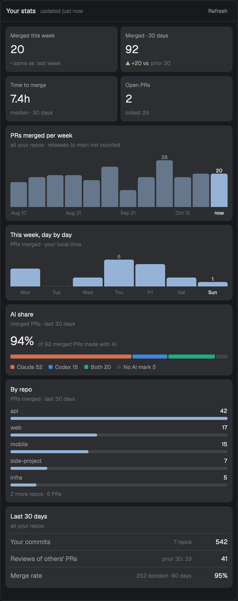

# Your stats

A side panel with your own delivery numbers across every GitHub repo you open PRs in: PRs merged
per week and per day, median time to merge, open PRs, how many of your merged PRs were made with
Claude or Codex, PRs and commits per repo, reviews of other people's PRs, and merge rate.

## What you see

- **Header** (42 px, 1 px `border` bottom): "Your stats" in semibold, "updated 4m ago" in `dim`,
  and a Refresh button (11 px, `muted`, `hover` background).
- **Tiles** (2 × 2, `raised`, 8 px radius): Merged this week (with ▲/▼ versus last week in `ansi2`
  / `ansi1`), Merged · 30 days (versus the prior 30), Time to merge (median, 30 days), Open PRs
  (oldest in days).
- **PRs merged per week:** 12 bars in `accent`, older weeks at 55% opacity, this week labelled
  "now"; values on this week and the tallest bar, every bar on hover.
- **This week, day by day:** Monday to Sunday, future days empty.
- **AI share:** the percent (rounded down) of merged PRs with an AI mark, one split bar with 2 px
  gaps (Claude `#d4704f`, Codex `#3f86e0`, Both `#1baf7a`, No AI mark `border`) and a legend with
  counts, so color is never the only label.
- **By repo:** the top five repos by merged PRs, one bar each in `accent`, commits on hover, then
  "N more repos · N PRs".
- **Last 30 days:** rows for your commits (and in how many repos), reviews of others' PRs (prior
  30 as a hint) and merge rate over 90 days.

## How it behaves

- Loads on open when the cached numbers are older than 30 minutes, checks every 5 minutes, and
  reloads on Refresh or the `stats:refresh` key command (`herdr-app do stats.refresh`).
- Only the computed numbers go into shared state `stats.v1` (`{ at, stats }`), no PR texts.
- Errors (for example "Run gh auth login first") show in `ansi1` above the last numbers.

## Built from

- One mod, `mods/stats`, `mod.json` `{ "place": "none", "title": "Your stats" }`, shown as a
  block in the side panel stack (`panel-body`) of a cloned layout, with a button in a cloned tab bar.
- `herdr` API: `exec` (`gh api graphql`), `readTextFile` and `appHome` (optional `stats.json`),
  `theme`, `shared` / `setShared`, `nextCommand`; elements `.tooltip`, `overflow_y_scrollbar`.
- `stats.js` is pure (no `herdr` imports), so `node --test` covers the counting.
- GitHub: per account, 13 weekly `search(type: ISSUE)` windows of `is:pr author:<login>` (search
  caps at 1,000 rows), with `body` and the last 15 commit messages only for the last 31 days; one
  aliased query for review counts and open PRs; one aliased query for commit counts per repo with
  `history(since, author: { id })`.

## Watch out

- An app started from the Dock can miss Homebrew on `PATH`: fall back to `/opt/homebrew/bin/gh`.
- Search windows overlap by a day; deduplicate by `repo#number` and keep the copy with AI marks.
- PR numbers repeat across repos, so never key by number alone.
- "Codex" in a PR body usually describes a Codex review: count only its "Generated with" line.

## Done when

- `herdr-app check mods/stats` passes and `node --test` passes.
- With `gh` logged in, the panel fills in within about 15 seconds and shows the same 30-day merged
  count as a GitHub search for `is:pr is:merged author:<you> merged:>=<30 days ago>` minus releases.
- Refresh shows "Loading…" and then "updated just now".
